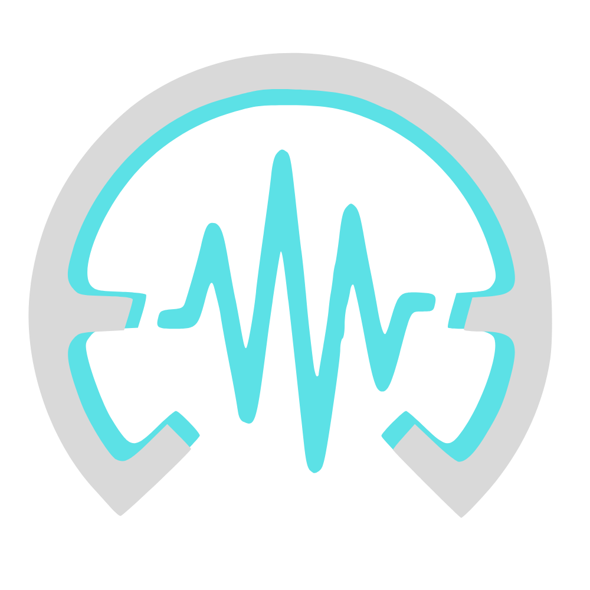
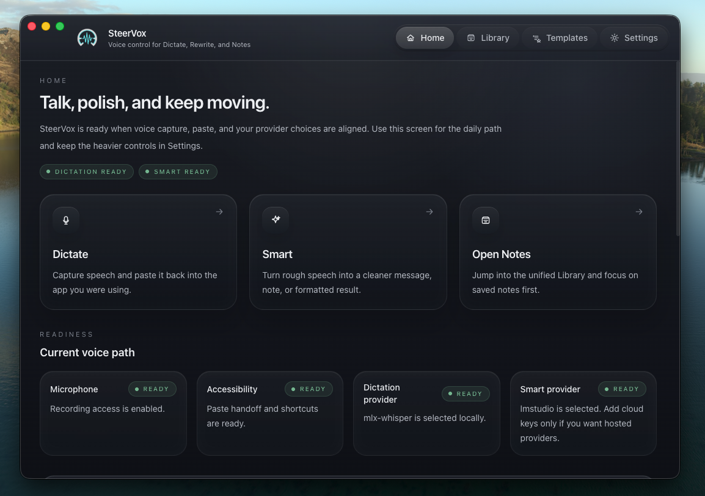
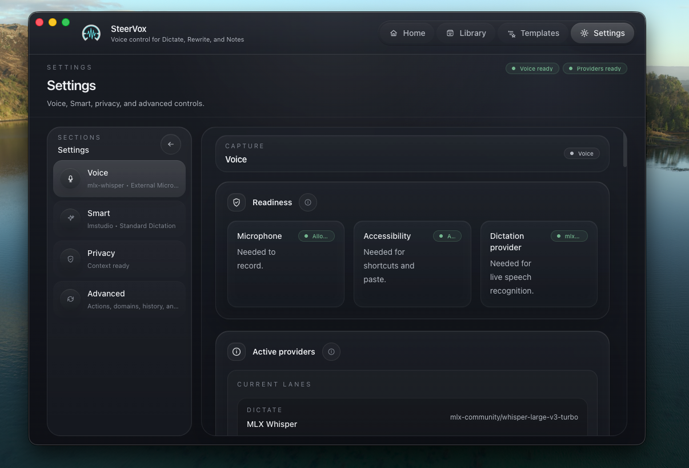
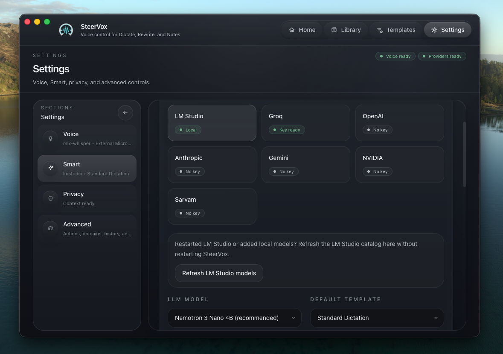
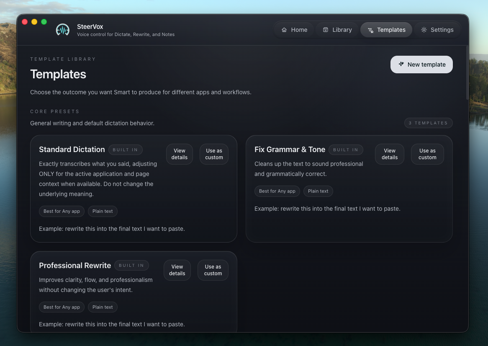
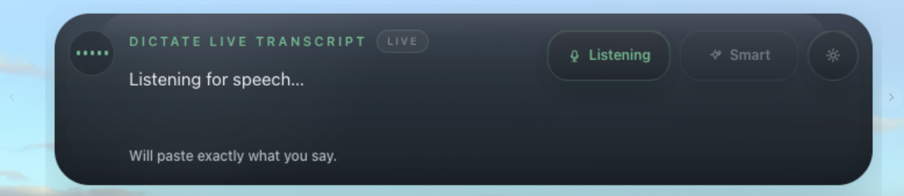

# SteerVox

<p align="center">
  
</p>

SteerVox is a macOS menu bar app for local-first dictation, AI-assisted rewriting, and reviewed desktop or repo tasks. Speak in any app, paste the transcript back where you were working, or use Smart Mode to turn rough speech into polished text with the smallest practical context.

SteerVox is source-available under the [SteerVox Limited Commercial Source License](LICENSE.md). Personal, educational, research, internal business, and evaluation use are allowed. Commercial distribution, hosted resale, OEM bundling, and paid managed-service use require a separate written license.

## Highlights

- Dictate directly into any app with a global shortcut.
- Use Smart Mode to rewrite, summarize, format, or route spoken text.
- Use selected text, clipboard text, app metadata, and optional screen context for higher-quality rewrites.
- Keep settings, notes, local memory, templates, history, logs, and secrets on your Mac.
- Use local STT with MLX Whisper on Apple Silicon, with cloud STT providers available when configured.
- Run reviewed local task-shell commands with a conservative allowlist.
- Build unsigned macOS beta DMGs or signed/notarized releases from the repo.

## Screenshots

### Home

<p align="center">
  
</p>

### Settings

<table>
  <tr>
    <td width="50%">
      
    </td>
    <td width="50%">
      
    </td>
  </tr>
</table>

### Templates And Widget

<table>
  <tr>
    <td width="50%">
      
    </td>
    <td width="50%">
      
    </td>
  </tr>
</table>

## Platform Support

- macOS only.
- Apple Silicon is the primary development and packaged-release target.
- Python 3.11 or newer.
- Node.js 22 or newer.
- Xcode Command Line Tools for Swift helper builds.

## Repository Layout

```text
SteerVox/
├── backend/                  # Python backend, providers, local stores, tests
├── frontend/                 # Electron main process, preload bridge, React UI
├── scripts/                  # Setup, verification, assets, and macOS release scripts
├── assets/                   # Public branding and screenshots
├── .github/                  # CI, issue templates, PR template
├── LICENSE.md
├── CONTRIBUTING.md
├── SECURITY.md
└── CODE_OF_CONDUCT.md
```

Generated native helper binaries, Swift module caches, local notes, local strategy material, virtualenvs, build outputs, and secrets are intentionally ignored.

## Quick Start

```bash
git clone https://github.com/SteerVox/SteerVox.git
cd SteerVox
./scripts/setup-dev.sh
cd frontend
npm run dev
```

The setup script creates `backend/.venv`, installs backend development dependencies, installs MLX Whisper on Apple Silicon, and runs `npm ci` for the Electron frontend.

`npm run dev` prepares macOS assets, prepares the local ffmpeg runtime, builds the native speech and system-control helpers, starts Vite, starts Electron, and lets Electron manage the backend process.

## First Run

On first launch, grant the macOS permissions that SteerVox prompts for:

- Microphone, for voice capture.
- Accessibility, for paste delivery and app interaction.
- Automation, for frontmost app and supported browser context.
- Speech Recognition, only if you enable native live transcription.

The default STT provider is MLX Whisper on Apple Silicon. The first transcription may download the configured model. If you prefer cloud STT, open Settings and choose a configured provider.

Smart Mode defaults to a local LM Studio-compatible setup when available. Cloud LLM providers require API keys configured in Settings.

## Environment

The Electron app normally manages backend environment details itself. For manual debugging, copy `.env.example` and export only what you need:

```bash
cp .env.example .env.local
```

Useful variables:

- `STEERVOX_HOME`: overrides the local app data directory.
- `STEERVOX_BACKEND_PORT`: pins the backend port.
- `STEERVOX_LOCAL_API_TOKEN`: required only when calling protected backend APIs manually.

## Manual Backend API

Only `/health` is unauthenticated. Every other local backend route requires the local API token header.

```bash
export STEERVOX_LOCAL_API_TOKEN="$(python3 - <<'PY'
import secrets
print(secrets.token_urlsafe(32))
PY
)"

cd backend
source .venv/bin/activate
python server.py --port 8055
```

In another terminal:

```bash
curl http://127.0.0.1:8055/status \
  -H "X-SteerVox-Token: $STEERVOX_LOCAL_API_TOKEN"
```

Provider keys can be stored through the protected API:

```bash
curl -X POST http://127.0.0.1:8055/secrets \
  -H "Content-Type: application/json" \
  -H "X-SteerVox-Token: $STEERVOX_LOCAL_API_TOKEN" \
  -d '{"provider":"openai","key":"sk-..."}'
```

Most users should use the Electron app instead of calling backend routes directly.

## Verification

Run the full local verification script before opening a pull request or cutting a release:

```bash
./scripts/verify-dev.sh
```

Useful focused checks:

```bash
backend/.venv/bin/python3 -m pytest backend/tests -q
cd frontend
npm run lint
./node_modules/.bin/tsc -b
npm test
./node_modules/.bin/vite build
```

## Release Build

Unsigned public-beta DMG:

```bash
bash scripts/build-mac.sh public-beta
```

Signed and notarized DMG:

```bash
export APPLE_SIGNING_IDENTITY="Developer ID Application: Your Company (TEAMID)"
export APPLE_ID="you@example.com"
export APPLE_APP_SPECIFIC_PASSWORD="xxxx-xxxx-xxxx-xxxx"
export APPLE_TEAM_ID="TEAMID"
bash scripts/build-mac.sh signed
```

Release artifacts are written under `frontend/release/` and are ignored by git.

## Contributing

Read [CONTRIBUTING.md](CONTRIBUTING.md) before opening a pull request. Keep changes scoped, run verification locally, and do not commit generated binaries, caches, secrets, or private planning material.

Security reports should follow [SECURITY.md](SECURITY.md). Community standards are in [CODE_OF_CONDUCT.md](CODE_OF_CONDUCT.md).

## License

SteerVox is licensed under the [SteerVox Limited Commercial Source License](LICENSE.md). This is a source-available license with commercial-use limits, not an OSI-approved open-source license.
