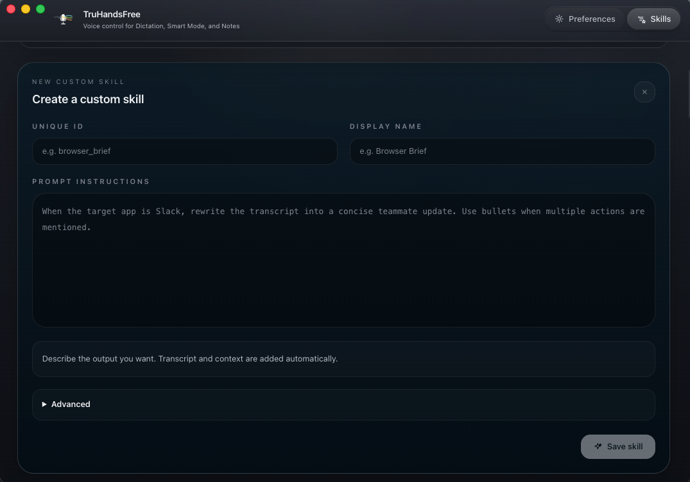
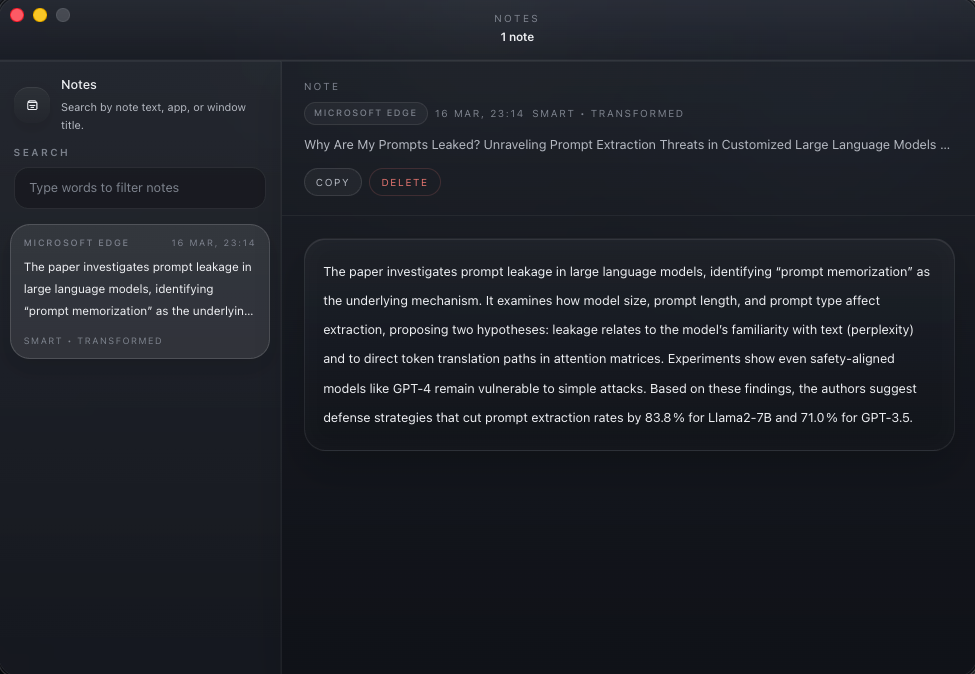
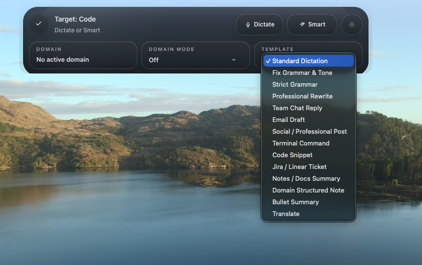
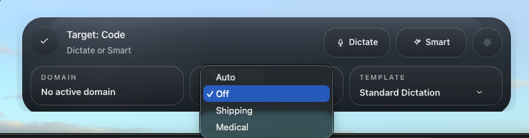
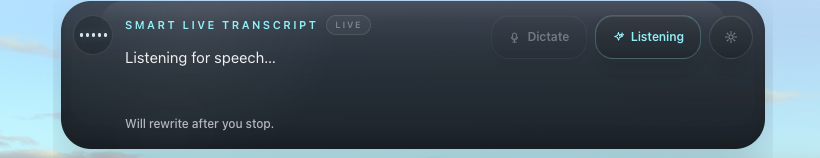

# SteerVox

<p align="center">
  
</p>

SteerVox is a macOS menu bar app for voice dictation and AI-assisted rewriting. You can speak into any app, paste the transcript back where you were working, or use Smart Mode to turn rough speech into something cleaner and more useful.

It is designed to stay light and local-first:

- your recording is captured on your Mac
- simple formatting tasks can stay local
- Smart Mode only uses the smallest context needed
- notes, settings, templates, and logs are stored locally

## What You Can Do With It

- Dictate directly into any app with a keyboard shortcut
- Use Smart Mode to rewrite what you said before it is pasted
- Work from selected text or clipboard text when you say things like `summarize this`
- Save spoken ideas or rewritten output into Notes instead of pasting them
- Use built-in templates for email, team chat, code help, tickets, summaries, social posts, and more
- Set different default templates for different apps or websites
- Add local dictionary entries, replacements, and snippets that run after transcription
- Let Smart Mode auto-learn lightweight preferences, facts, and term swaps in a local memory store
- Edit Shipping and Medical domain packs locally in Settings
- Review text-only history and reprocess past runs without storing audio
- Tighten privacy with sensitive-target rules and clipboard restore

## Screen Gallery

### Home

<p align="center">
  
</p>

### Settings

<table>
  <tr>
    <td width="50%">
      
    </td>
    <td width="50%">
      
    </td>
  </tr>
  <tr>
    <td align="center"><sub>Voice capture, readiness, and active providers</sub></td>
    <td align="center"><sub>Smart providers, models, and default template</sub></td>
  </tr>
</table>

### Templates

<table>
  <tr>
    <td width="50%">
      
    </td>
    <td width="50%">
      
    </td>
  </tr>
  <tr>
    <td align="center"><sub>Template library</sub></td>
    <td align="center"><sub>Create a custom template</sub></td>
  </tr>
</table>

### Library

<p align="center">
  
</p>

### Widget

<table>
  <tr>
    <td width="50%">
      
    </td>
    <td width="50%">
      
    </td>
  </tr>
  <tr>
    <td align="center"><sub>Template picker in the floating widget</sub></td>
    <td align="center"><sub>Domain mode picker in the floating widget</sub></td>
  </tr>
  <tr>
    <td width="50%">
      
    </td>
    <td width="50%">
      
    </td>
  </tr>
  <tr>
    <td align="center"><sub>Dictation live transcript</sub></td>
    <td align="center"><sub>Smart live transcript</sub></td>
  </tr>
</table>

## Platform Support

- macOS only
- packaged build target: Apple Silicon (`arm64`)
- normal use is menu-bar first, not Dock-first

## Project Layout

```text
SteerVox/
├── backend/                  # Local Python service for speech, Smart Mode, settings, and notes
├── frontend/                 # Electron app and React screens
├── scripts/build-mac.sh      # macOS release build script
├── scripts/prepare-mac-assets.sh
└── assets/                   # Branding and screenshots
```

## Before You Start

You will need:

- macOS
- Python 3.11+
- Node.js 22+
- at least one provider you can use

Cloud providers:

- Groq
- OpenAI
- Anthropic
- Gemini
- Deepgram

Local options where supported:

- LM Studio
- MLX Whisper

Groq is the default cloud setup for Smart Mode and for the optional Smart router fallback.

## Local Setup

### 1. Clone the repo

```bash
git clone <repo-url> SteerVox
cd SteerVox
```

### 2. Set up the backend environment

```bash
cd backend
python3 -m venv .venv
source .venv/bin/activate
python3 -m pip install --upgrade pip==26.0.1
python3 -m pip install -r requirements.txt
cd ..
```

### 3. Install frontend dependencies

```bash
cd frontend
npm ci
cd ..
```

### Optional: local speech recognition with MLX Whisper

This is only for Apple Silicon Macs and is not part of the default install.

```bash
cd backend
source .venv/bin/activate
python3 -m pip install -r requirements-mlx.txt
cd ..
```

You also need:

```bash
brew install ffmpeg
```

`ffmpeg` must be available on your `PATH` for MLX Whisper to work.

## Run The App In Development

Start the app from the `frontend` folder:

```bash
cd frontend
npm run dev
```

This starts:

- the Vite development server
- the Electron app
- the local backend from `../backend/.venv/bin/python3`

Before Vite starts, the dev command also:

- syncs generated branding files from `branding/identity.json`
- refreshes macOS app assets if they are stale
- rebuilds the local speech and system-control helper binaries when needed

You do not need to start the backend in a second terminal for normal development.

After launch:

- the app appears in the menu bar
- the floating widget starts hidden
- you can open Settings from the tray menu
- `Ctrl + D` starts Dictation
- `Ctrl + T` starts Smart Mode

## How Dictation And Smart Mode Work

### Dictation

Dictation records what you say, turns it into text, and pastes it back into the app you were using.

### Smart Mode

Smart Mode does more than basic dictation. It can:

- clean up phrasing
- rewrite your text for a specific purpose
- use a built-in or custom template
- apply optional Shipping or Medical domain packs
- work from selected text or clipboard text when your command refers to it
- save the result to Notes instead of pasting it

When Smart Mode starts, the app can capture:

- the frontmost app name
- the app bundle id
- the window title
- browser page title when available
- browser hostname
- a sanitized page path
- selected text when available
- clipboard text as a fallback

It does not send:

- full page content
- URL query strings
- URL fragments

Selected text or clipboard text is only used when the command actually refers to it, for example:

- `summarize this`
- `translate this into Spanish`
- `rewrite this professionally`

If a domain pack is active, the app can also:

- correct known terms and acronyms after transcription
- add one local template, one example, and local style hints before the Smart rewrite
- apply pack controls such as preferred format, surface behavior, tone, audience, and privacy defaults

Domain packs and imported overlays stay on your Mac. They are not uploaded as a separate dataset.

## Local Writing Tools

Settings includes three local writing tools that run after transcription:

- `Dictionary` for one canonical output plus the spoken aliases or common mishearings that should resolve to it
- `Replacements` for deterministic phrase rewrites
- `Snippets` for exact or inline trigger expansion

These tools are stored locally in SQLite (`~/.steervox/writing_memory.sqlite3`) and do not add extra model calls to the live Dictation or Smart path. The global dictionary applies across the app, while domain glossaries add extra domain-only vocabulary when Shipping or Medical is active. Match logic uses word-boundary matching so triggers do not fire inside identifiers, and code-surface targets (Cursor, VS Code, terminals, etc.) are skipped automatically.

Per-entry safety limits keep the store predictable on long-running installs:

- source text up to 256 characters
- canonical or "to" text up to 512 characters
- replacement text up to 2048 characters
- snippet trigger up to 256 characters
- snippet expansion up to 8192 characters
- text-only run history capped at 1000 rows with the oldest pruned automatically

The matching pipeline, retrieval rules, and safety limits are implemented in `backend/writing_memory.py` and exercised by tests under `backend/tests/`.

## Local Memory

Smart Mode keeps a small local memory store at `~/.steervox/local_memory.sqlite3`. It can capture lightweight preferences, facts, projects, and term swaps that you mention during dictation, then surface a few relevant lines as extra context on later Smart runs in the same scope (app, browser host, or domain).

Memory is opt-in from Settings. Nothing is uploaded as a separate dataset, scope matching is case-insensitive, retrieval is bounded by a per-prompt character budget, and you can review or delete entries through the `/memories` API or by clearing the SQLite file.

## Domain Controls

Shipping and Medical packs can now be edited directly in Settings.

For each pack you can adjust:

- vocabulary
- templates
- examples
- output controls such as format and surface behavior
- tone and audience
- privacy options such as suppressing selected text or minimizing captured context

Medical stays limited to documentation assistance. It does not provide diagnosis or treatment guidance.

## Local History

The Support section keeps a text-only local history of successful Dictation and Smart runs.

Each history item can:

- copy the original transcript
- copy the final output
- be reprocessed with your current configuration
- be deleted locally

Audio is not stored in this history.

## Privacy Controls

Settings also includes local privacy controls for:

- restoring the previous clipboard after paste
- reducing Smart Mode context for sensitive apps or websites
- blocking selected text and clipboard text on matched sensitive targets

Medical defaults start more conservatively by minimizing captured context and suppressing external text unless you change those settings.

## How Smart Mode Chooses What To Do

Smart Mode follows a local-first flow:

1. it decides whether the result should be pasted or saved to Notes
2. it can activate a Shipping or Medical domain pack from local rules or your Settings
3. it picks the right skill for the current app or site
4. it tries local routing rules first
5. if the request is still unclear, it can use Groq Compound Mini as a fallback router
6. it then either:
   - keeps the spoken text as-is
   - applies a simple local cleanup
   - sends the request to the selected AI model

Important behavior:

- you do not need to manually configure every app
- built-in starter rules already cover tools like ChatGPT, Claude, Gemini, Make, n8n, Flowise, Cursor, VS Code, Windsurf, Codex, Antigravity, and Cloud Code
- manual overrides are only needed when you want different behavior from the built-in defaults
- domain packs are optional and local-only
- action routing stays local in the current version
- if the Smart router fallback fails, the app falls back to the local route instead of stopping

If you want the code-level reference, start with:

- `backend/engine.py`
- `backend/agent/processor.py`
- `backend/action_routing.py`

## Skills

SteerVox includes built-in skills and also supports custom skills.

Built-in examples include:

- Standard Dictation
- Fix Grammar & Tone
- Strict Grammar
- Rewrite
- Team Chat Reply
- Email Draft
- Terminal Command
- Code Snippet
- Jira / Linear Ticket
- Notes / Docs Summary
- Bullet Summary
- Translate
- Social Post Draft
- Agent Action Builder
- Prompts for tools like ChatGPT, Codex, Antigravity, and Cloud Code

System skills ship as packages under `backend/agent/skills/system_packages/<id>/SKILL.md`. Custom skills you create live under `~/.steervox/skills/<id>/SKILL.md`. The legacy single-file `~/.steervox/skills.json` is migrated automatically on first launch and a `.bak` copy is kept beside it.

You can also set different default skills for different apps or websites from Preferences.

## Notes

Notes are for ideas or Smart Mode results that should be saved instead of pasted.

Current behavior:

- plain Dictation does not auto-save notes
- note capture starts from Smart Mode only
- note-saving is designed to favor explicit phrases so the app does not accidentally dump content into Notes

Examples:

- `take a note of this`
- `please note it down`
- `summarize this and take a note`

When a note is saved:

- nothing is pasted into the current app
- the note is stored locally
- you can review it in the Notes window

The Notes window includes:

- a sidebar list
- search
- app filter
- full note detail view
- copy
- copy and archive
- delete

## API Keys

The normal way to add provider keys is through Preferences.

Secrets are stored locally at:

```text
~/.steervox/.env_secrets
```

The file is intended to be owner-only (`0600`).

If you want to run the backend manually for debugging:

```bash
cd backend
source .venv/bin/activate
python server.py --port 8055
```

Then you can call it directly:

```bash
curl -X POST http://127.0.0.1:8055/secrets \
  -H "Content-Type: application/json" \
  -d '{"provider":"groq","key":"YOUR_API_KEY"}'
```

That fixed port is only for manual debugging. The Electron app uses a random local port during normal development.

## macOS Permissions

The app needs:

- Microphone
- Accessibility
- Automation

Why:

- Microphone: record your voice
- Accessibility: global shortcuts and paste text back into apps
- Automation: read frontmost-app details and supported browser context

Notes:

- development prompts may appear under Electron or tooling names
- packaged builds still need the microphone entitlement
- if the app seems missing, check the menu bar first

## Keyboard Shortcuts

- `Ctrl + D`: Dictation
- `Ctrl + T`: Smart Mode

Each shortcut is a toggle:

1. press once to start recording
2. speak
3. press again to stop and process

## Build A macOS Package

Run this from the repo root:

```bash
bash scripts/build-mac.sh
```

The build script currently:

1. prepares the brand assets
2. bundles the backend with PyInstaller
3. smoke-tests the bundled backend
4. installs frontend dependencies
5. builds the Electron arm64 DMG

If you need backend packaging tools locally:

```bash
cd backend
source .venv/bin/activate
python3 -m pip install -r requirements-build.txt
```

Build output:

- `frontend/dist/SteerVox-<version>-arm64.dmg`
- `frontend/dist/mac-arm64/SteerVox.app`

Optional signing and notarization environment variables:

```bash
export APPLE_SIGNING_IDENTITY="Developer ID Application: Your Company (TEAMID)"
export APPLE_ID="you@example.com"
export APPLE_APP_SPECIFIC_PASSWORD="xxxx-xxxx-xxxx-xxxx"
export APPLE_TEAM_ID="TEAMID"
```

Without those values, the build can still complete locally with ad-hoc signing for testing.

For the current public release track, use the direct-download DMG build path described in this README. The repo does not yet produce a Mac App Store submission build.

## Logs And Local Data

Useful local paths:

- Config: `~/.steervox/config.json`
- Secrets: `~/.steervox/.env_secrets`
- Custom skills: `~/.steervox/skills/<id>/SKILL.md`
- Legacy skills (migrated on first launch): `~/.steervox/skills.json` and `~/.steervox/skills.json.bak`
- Local memory store: `~/.steervox/local_memory.sqlite3`
- Writing tools store: `~/.steervox/writing_memory.sqlite3`
- Domain overlays: `~/.steervox/domain_memory.sqlite3`
- Inbox: `~/.steervox/inbox.jsonl`
- Temp audio: `~/.steervox/temp`
- Debug recordings: `~/.steervox/recordings`
- Electron log: `~/.steervox/logs/electron.log`
- Backend log: `~/.steervox/logs/app.log`

If you want isolated local state for testing:

```bash
export STEERVOX_HOME=/some/path
```

Set that before launching the backend or app.

## Developer Notes

High-level split:

- Electron main process: tray, windows, hotkeys, backend lifecycle, paste, notifications
- Electron capture host: microphone capture and device list
- React renderer: settings, skills, widget, notes
- Python backend: speech recognition, Smart Mode, deterministic transforms, skills, domain memory, config, notes

Helpful code-level references:

- `backend/action_routing.py`
- `backend/skill_selection.py`
- `backend/agent/router.py`
- `backend/agent/smart_router_agent.py`
- `backend/agent/processor.py`
- `backend/agent/skills/manager.py`
- `backend/engine.py`
- `backend/local_memory.py`
- `backend/writing_memory.py`
- `backend/api/memory_router.py`
- `backend/api/writing_tools_router.py`

The backend does not capture microphone audio directly.

## Tests

Backend tests:

```bash
cd backend
python3 -m pip install --upgrade pip==26.0.1
python3 -m pip install -r requirements-dev.txt
python -m pytest -q
```

Frontend checks:

```bash
cd frontend
npm run lint
./node_modules/.bin/tsc -b
./node_modules/.bin/vite build
```

Manual smoke checks live under `backend/manual_checks/`.

## License

MIT
